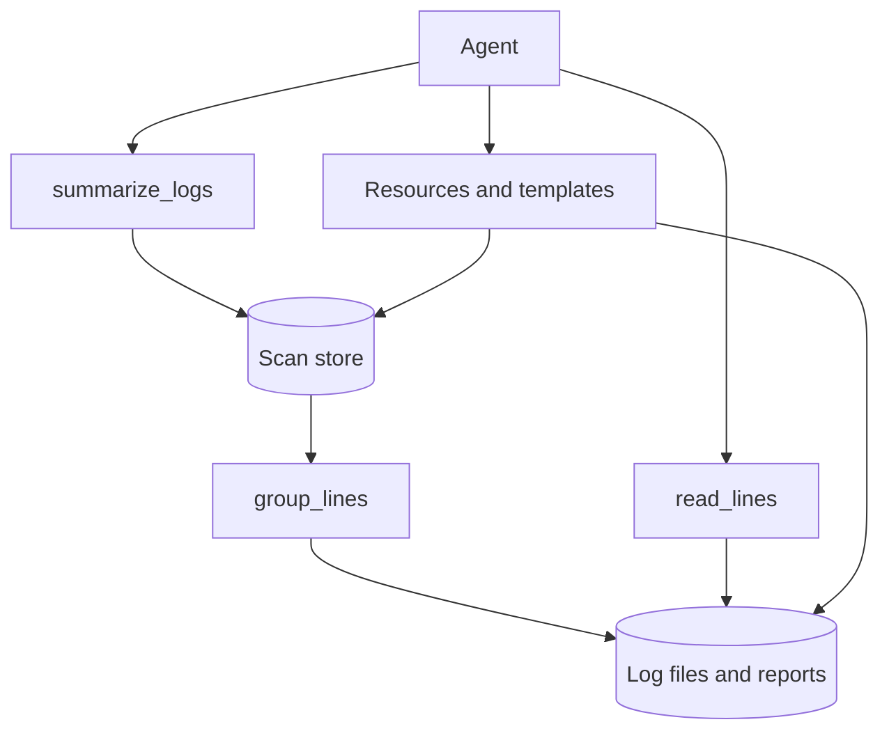

# Practice 2: State, safety, and errors (Python)

**Practice files**:

> [CONTRACT](CONTRACT.md): The exact MCP surface and behavior after this stage
> [interface](interface.md): The state-design worksheet
> [hostile-inputs](hostile-inputs.md): Inputs to try against path and file safety
> [CHECKLIST](CHECKLIST.md): The completion record for this stage
> [CLAUDE](CLAUDE.md): Rules for Claude Code while it builds this stage
> [AGENTS](AGENTS.md): The same rules for other coding agents
> [Inspector config](inspector.json): The normal, read-only, short-lived, and hostile-root servers

Your existing Log Triage server lists, summarizes, and searches logs and saves findings. This stage adds reusable scans, bounded follow-up reads, resources, path confinement, and caller-facing errors.

The contract defines behavior visible through MCP. It does not prescribe package names or the internal file layout, and your implementation stays in `solution/`.

## Links
- [FastMCP documentation](https://gofastmcp.com/getting-started/welcome)
- [MCP specification: Resources](https://modelcontextprotocol.io/specification/2026-07-28/server/resources)
- [MCP Inspector CLI](https://modelcontextprotocol.io/docs/2026-07-28/tools/inspector/cli)
- [MCP Inspector protocol eras](https://modelcontextprotocol.io/docs/2026-07-28/tools/inspector/protocol-eras)

**Project references**:

- [Practice 1 contract](../1-surface-and-contract/CONTRACT.md)
- [Log formats](../docs/log-formats.md)
- [Corpus guide](../docs/s3-logs.md)
- [Server guide](../solution/README.md)

## What you will build
- server name `log-triage` and version `0.2.0`;
- six tools, with `group_lines` and `read_lines` joining the four existing tools;
- two resources and two resource templates under the `triage://` scheme;
- expiring scan handles owned by the fixed local caller;
- resource cache hints, path confinement, file limits, exact domain errors, and masked unexpected failures.

The checks start the program as a separate process and talk MCP to it, so your internal design remains your choice.

## How state and resources fit

The diagram shows which calls create reusable state and which calls reopen bounded evidence or documents without repeating a whole scan.

## MCP surface in this stage
This stage has six tools, two resources, and two resource templates. It publishes no MCP prompts.

### Tools
| Tool | Main goal | Example input |
|---|---|---|
| `list_logs` | List files and detected formats | `{"path":"vms"}` |
| `summarize_logs` | Count and group messages, then mint a scan id | `{"path":"vms/db-01","min_level":"warning"}` |
| `search_logs` | Find matching lines | `{"path":"vms","pattern":"timeout"}` |
| `save_finding` | Create one evidence-backed report | `{"title":"Connection slots exhausted","severity":"high","summary":"...","evidence":[...]}` |
| `group_lines` | Page the lines of one stored group | `{"scan_id":"<scan-id>","group_id":"<group-id>"}` |
| `read_lines` | Read a bounded window around one line | `{"path":"vms/db-01/postgres.log","line":120}` |

Use `summarize_logs` for the broad pass, then reuse its `scan_id` with `group_lines`. Use `read_lines` when a search result or group line needs nearby context. `search_logs` remains the better choice when you already know the expression to find.

Example summary input:

```json
{
  "path": "vms/cache-01/syslog.log",
  "since": "2026-09-07",
  "until": "2026-09-08",
  "min_level": "any",
  "limit": 20
}
```

The result contains a random `scan_id`, an `expires_at` value, and the normal summary fields. A later `group_lines` call uses the returned identifiers:

```json
{
  "scan_id": "s_0123456789abcdef",
  "group_id": "0123456789ab",
  "limit": 50,
  "offset": 0
}
```

Use the ids and file paths returned by your running server. The placeholders above are illustrative.

### Resources
Resources let a host fetch addressable context without asking the model to choose a tool.

| URI | Kind | Goal | Example use |
|---|---|---|---|
| `triage://formats` | Resource | Describe supported log formats | Read before interpreting unfamiliar logs |
| `triage://reports` | Resource | List valid saved findings | Find reports the server may reopen |
| `triage://reports/{name}` | Template | Read one listed finding | Open a report by its returned name |
| `triage://scans/{scan_id}` | Template | Read one stored summary | Reopen a valid scan by its returned id |

Resource lists and reads carry the contract's private freshness metadata. An unknown report, expired scan, or another caller's scan returns a resource-not-found protocol error.

### Prompts
This stage publishes no MCP prompts. Coding-agent prompts belong to the lesson and are not part of the server surface.

## Design reminders
A handle is a name for retained work, not proof of identity. Decide what the server keeps, who may use it, when it expires, how many handles one caller may hold, and which handle is removed when the cap is reached. The exact values and error text live in [CONTRACT.md](CONTRACT.md).

Every resource list and read carries freshness hints. They help a client decide whether it may reuse an answer, but they do not replace access checks or state ownership.

Synchronous FastMCP tool handlers run on worker threads. Keep compound scan-store operations under one lock so concurrent calls observe the same expiry and eviction rules.

## Error model
| Failure class | Where it appears | What the caller needs |
|---|---|---|
| Schema refusal | Tool result produced before the handler runs | Which argument shape or bound failed |
| Expected domain failure | Tool result with `isError: true` | The contract text and the next useful action |
| Missing resource | JSON-RPC resource-not-found error | The URI that could not be read |
| Unexpected failure | Masked tool error | A generic message with no path, exception, or stack trace |

Path checks apply to direct arguments, entries found while walking, and stored paths reopened later. Rechecking a stored path prevents a file or parent directory replaced with a symlink from escaping the configured root.

## Repository map
Only the student-facing folders used in this stage are shown:

```text
build-your-own-mcp-fastmcp/
  1-surface-and-contract/  previous contract and regression checks
  2-state-safety-errors/   current contract, worksheet, Inspector config, and checks
  docs/                    log formats and corpus reference
  s3_logs/                 read-only input corpus
  reports/                 findings saved through the server
  solution/                your existing FastMCP server, extended in place
```

Keep `s3_logs/`, `docs/`, contracts, and check suites read-only. Your server implementation remains in `solution/`.

## Set up the project
Use Python 3.13, uv 0.11 or newer, FastMCP 4.0.3 from the server lockfile, Node.js 22.19 or newer, git, and a coding agent.

Run these commands from the repository root:

```bash
# Run from the repository root.
uv run --project 1-surface-and-contract/checks pytest 1-surface-and-contract/checks
uv sync --project 2-state-safety-errors/checks --locked
uv run --project 2-state-safety-errors/checks pytest 2-state-safety-errors/checks
```

The first suite must pass before you begin. The second suite initially fails across the stage-two files because your carried-forward server still publishes version `0.1.0` and lacks this stage's surface.

## Suggested build order
1. Complete [interface.md](interface.md) and compare your state choices with the contract.
2. Add the scan store, lifetime flag, version, and instructions.
3. Add `group_lines` and retain the positions it pages.
4. Add `read_lines` and its bounded context window.
5. Publish resources, templates, not-found behavior, and freshness hints.
6. Apply path screening and file limits to direct reads, walks, and stored rereads.
7. Finish expected errors, create-only findings, and masking.

Use the lesson for the coding-agent prompts and the investigation case.

## Verify each capability
Run both suites from the repository root:

```bash
# Run from the repository root.
uv run --project 2-state-safety-errors/checks pytest 2-state-safety-errors/checks
uv run --project 1-surface-and-contract/checks pytest 1-surface-and-contract/checks
```

| Check file | Capability |
|---|---|
| `test_t2_scans.py` | Version, exact configured lifetime text, scan ids, expiry, and concurrent storage |
| `test_t3_group_lines.py` | Stored-group paging, caps, expiry, eviction, and stable membership |
| `test_t4_read_lines.py` | Context windows and file-boundary errors |
| `test_t5_resources.py` | Resources, templates, report-name consistency, not-found, and cache hints |
| `test_t6_paths.py` | Direct paths, walking, stored rereads, symlink replacement, limits, and skips |
| `test_t7_checks.py` | Time and regex errors, create-only metadata, evidence checks, and masking |

Run one file alone from the repository root, for example:

```bash
# Run from the repository root.
uv run --project 2-state-safety-errors/checks pytest 2-state-safety-errors/checks/test_t6_paths.py
```

## Inspect the published surface
Use direct Inspector commands from `2-state-safety-errors/`. FastMCP 4.0.3's `fastmcp dev inspector` wrapper passes only a bare `fastmcp run ... --no-banner` command. It cannot load this folder's configuration or select the protocol era, so its ad-hoc Inspector target defaults to legacy `2025-11-25`. The supplied config selects the named server variants and sets `protocolEra` to `modern`, which pins `2026-07-28`.

```bash
# Run from 2-state-safety-errors/.
npx @modelcontextprotocol/inspector --cli --config inspector.json --server log-triage --method tools/list --format json
npx @modelcontextprotocol/inspector --cli --config inspector.json --server log-triage --method resources/list --format json
npx @modelcontextprotocol/inspector --cli --config inspector.json --server log-triage --method resources/templates/list --format json
npx @modelcontextprotocol/inspector --cli --config inspector.json --server log-triage --method resources/read --uri triage://formats --format json
```

The normal server lists six tools, two resources, two templates, and nine formats. `log-triage-read-only` lists five tools and omits `save_finding`. Printed list results omit modern envelope fields, while the resource read prints `ttlMs` and `cacheScope`. The Protocol tab in the browser Inspector shows `resultType`, `ttlMs`, and `cacheScope` on the raw modern response.

Every CLI invocation starts a new server process. Use the browser Inspector with the same config when one scan id must survive across calls, including the five-second expiry watch. Build the temporary hostile root from [hostile-inputs.md](hostile-inputs.md) before selecting `log-triage-hostile`.

## Completion check
- Both practice suites pass from the repository root.
- The Inspector lists the expected tools, resources, and templates.
- A short-lived scan works once and then answers the expiry error.
- Every hostile input produces the result in `hostile-inputs.md`.
- Your case finding is saved under `reports/` and its evidence lines were checked.
- Every item in [CHECKLIST.md](CHECKLIST.md) is complete.
