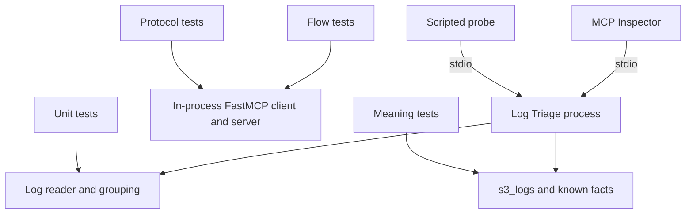

# Practice 3: Testing and Debugging the Server (Python)

**Practice files**:

> [Contract](CONTRACT.md): Exact stage-three surface and runtime behavior
> [Tricky cases](tricky-cases.md): Edge-case log lines for unit tests
> [Known facts](facts.json): Corpus facts for meaning tests
> [Mutations](mutations.md): Three intentional defects your tests should catch
> [Probe transcript](probe-expected.md): Required scripted-client behavior
> [Checklist](CHECKLIST.md): Manual completion checks
> [Coding-agent instructions](CLAUDE.md): Scope and constraints for AI-assisted work

Turn the stage-two Log Triage server into a project you can test and diagnose. You will add tests at several boundaries, build a scripted MCP client, observe calls through stderr logging, and add a `timeline` tool for trends that a single summary cannot show.

This practice continues the same server in `solution/`. Keep the earlier tools, resources, state rules, safety behavior, and errors working while you add tests and the new tool. The contract defines visible behavior, while you design the internal test and package structure within the stated file categories.

## Links
- [FastMCP 4 testing documentation](https://gofastmcp.com/servers/testing)
- [FastMCP middleware documentation](https://gofastmcp.com/servers/middleware)
- [pytest documentation](https://docs.pytest.org/en/stable/)
- [MCP Inspector CLI](https://modelcontextprotocol.io/docs/2026-07-28/tools/inspector/cli)

**Project references**:

- [Earlier state and safety contract](../2-state-safety-errors/CONTRACT.md)
- [Log format rules](../docs/log-formats.md)
- [Log bundle guide](../docs/s3-logs.md)

## What you will build
Your stage-three project will:

- identify the server as version `0.3.0`;
- add focused unit tests for parsing and grouping;
- add in-process MCP protocol tests and whole investigation flows;
- test real corpus meaning against [facts.json](facts.json);
- provide a scripted stdio client that exercises success and refusal paths;
- prove test quality by planting and removing three meaning-changing defects;
- add `--log-level` and one `tool=<name>` line per tool call at debug level;
- expose `timeline` for counts and numeric trends across time buckets.

This stage does not add HTTP or an MCP prompt. Stdio remains the transport, and `local` remains the caller. The checks start your program as a separate process and talk MCP to it, so your production package design remains yours.

## How the test layers fit


The diagram shows which tests bypass MCP, which use an in-process client, and which cross the stdio process boundary. Meaning tests compare answers with known facts, so they can catch a wrong count that still satisfies the output schema.

## MCP surface in this stage
The server now has seven tools. It keeps the two resources and two resource templates from the previous stage. It still publishes no MCP prompts.

### Tools
| Tool | Main goal | Example input |
|------|-----------|---------------|
| `list_logs` | Discover files and formats | `{"path":"pods","limit":20}` |
| `summarize_logs` | Produce counts, groups, and a reusable scan | `{"path":"pods","since":"2026-09-01","until":"2026-09-02"}` |
| `search_logs` | Find exact raw evidence with a regular expression | `{"path":"pods","pattern":"(?i)timeout","limit":20}` |
| `group_lines` | Page one group from a scan | `{"scan_id":"<scan-id>","group_id":"<group-id>","limit":50}` |
| `read_lines` | Read context around one source line | `{"path":"path/from-a-result.log","line":123,"before":5,"after":10}` |
| `timeline` | Count matching lines by time bucket and summarize captured values | `{"scan_id":"<scan-id>","pattern":"latency","bucket_minutes":1440}` |
| `save_finding` | Save a new evidence-backed report | `{"title":"Investigation title","severity":"medium","summary":"...","evidence":[...]}` |

### `timeline`
Use `timeline` after `summarize_logs` when the question asks how something changed over time. The tool rereads the scan's file set inside its original window and returns every bucket, including empty ones.

Example input with numeric extraction:

```json
{
  "scan_id": "s_0123456789abcdef",
  "pattern": "latency_ms=",
  "bucket_minutes": 1440,
  "value_pattern": "latency_ms=(\\d+)"
}
```

For each bucket, the result reports a count and, when values were captured, `min`, `median`, and `max`. The identifiers and expression illustrate the input shape. Use values returned by your running server and a pattern that matches your investigation. The exact bounds and error texts are in [CONTRACT.md](CONTRACT.md).

### Resources
| URI | Kind | Main goal | Example use |
|-----|------|-----------|-------------|
| `triage://formats` | Resource | Describe the supported formats | Read before interpreting parsed fields |
| `triage://reports` | Resource | List saved findings | Discover report names after an investigation |
| `triage://reports/{name}` | Resource template | Read one finding | Replace `{name}` with a name returned by `triage://reports` |
| `triage://scans/{scan_id}` | Resource template | Read one stored summary | Replace `{scan_id}` with an id returned by `summarize_logs` |

The resource contracts do not change in this stage.

### Prompts
The server publishes no MCP prompt yet. The coding-agent prompts in the practice lesson help build the project and are not part of the server's MCP surface.

## Debugging contract
Stdio uses standard output for protocol frames. Send application diagnostics to standard error so clients can continue parsing the connection.

At `--log-level debug`, every call to a registered tool writes one stderr line containing `tool=<name>`, including calls rejected by schema validation. Higher log levels omit those call lines. A masked unexpected error writes its private detail to stderr at error level while the MCP caller receives only the generic tool error.

The scripted probe acts like a careless host. It uses a scan before creating it, uses another scan after expiry, sends an unknown argument, and sends a path that climbs outside the root. Its required requests and line format live in [probe-expected.md](probe-expected.md).

## Repository map
Only the student-facing folders are shown. Your source-file layout is yours to design.

```text
build-your-own-mcp-fastmcp/
├── 1-surface-and-contract/       # Earlier regression checks
├── 2-state-safety-errors/        # Earlier regression checks
├── 3-testing-and-debugging/      # Current contract, fixtures, checks, and Inspector config
├── docs/                         # Log formats and corpus notes
├── reports/                      # Investigation findings
├── s3_logs/                      # Read-only input corpus
└── solution/                     # Your server, its tests, and the probe
```

Your own tests belong beside the code they exercise. The practice checks identify test categories by location and file name, but the production package structure stays under your control.

## Set up the project
You need Python 3.13, uv 0.11 or newer, Node.js 22.19 or newer, Git, and a coding agent or editor. FastMCP 4.0.3 is pinned by the server project.

From the repository root:

```bash
# Run from the repository root.
uv run --project 1-surface-and-contract/checks pytest 1-surface-and-contract/checks
uv run --project 2-state-safety-errors/checks pytest 2-state-safety-errors/checks
uv sync --project 3-testing-and-debugging/checks
uv run --project 3-testing-and-debugging/checks pytest 3-testing-and-debugging/checks
```

The first two suites should pass. The current suite initially fails because the project lacks your tests, probe, logging behavior, and `timeline`. Read the practice lesson for the order of work.

## Suggested build order
1. Write unit tests from [tricky-cases.md](tricky-cases.md).
2. Test every existing tool and resource through FastMCP's in-process client.
3. Add whole investigation flows that reuse scans and inspect evidence.
4. Add meaning tests using [facts.json](facts.json).
5. Build the scripted probe from [probe-expected.md](probe-expected.md).
6. Apply each mutation from [mutations.md](mutations.md), record the failing test, and undo the mutation.
7. Add protocol-safe logging.
8. Add `timeline` and extend your protocol tests.
9. Run all earlier suites after each increment.

The practice lesson contains the coding-agent prompts and investigation cases. This README explains the project and its test boundaries.

## Run your own tests
Run all tests inside the implementation project:

```bash
# Run from the repository root.
uv run --project solution pytest solution/tests
```

Run one layer while working on the reader:

```bash
# Run from the repository root.
uv run --project solution pytest solution/tests/unit
```

Commit or stash before each supplied mutation. Review the changed paths before restoring production files, so any test added during a mutation remains.

## Run the scripted probe
From the repository root:

```bash
# Run from the repository root.
uv run --project solution python solution/scripts/probe.py --root s3_logs
```

The probe should print the five steps described in [probe-expected.md](probe-expected.md) and exit successfully only when every result matches its expected category.

## Verify each capability
Run the current and earlier suites:

```bash
# Run from the repository root.
uv run --project 3-testing-and-debugging/checks pytest 3-testing-and-debugging/checks
uv run --project 2-state-safety-errors/checks pytest 2-state-safety-errors/checks
uv run --project 1-surface-and-contract/checks pytest 1-surface-and-contract/checks
```

| Check file | Capability |
|------------|------------|
| `test_t1_unit.py` | Student unit tests build, run, and cover the required minimum |
| `test_t2_protocol.py` | In-process protocol tests and complete flows |
| `test_t3_meaning.py` | Meaning tests, corpus facts, and the whole student suite |
| `test_t4_probe.py` | Scripted probe requests and transcript |
| `test_t6_logging.py` | Log levels, one call line, stdout safety, and masked-error detail |
| `test_t7_timeline.py` | Tool schema, buckets, values, medians, limits, and errors |

The checks of your own tests and probe are skipped when `LOG_TRIAGE_CMD` points at another build.

## Inspect the published surface
From `3-testing-and-debugging/`, list the tools:

```bash
# Run from 3-testing-and-debugging/.
npx @modelcontextprotocol/inspector --cli \
  --config inspector.json \
  --server log-triage \
  --method tools/list \
  --format json
```

The result should contain seven tools, including `timeline`. The supplied `inspector.json` selects the modern `2026-07-28` protocol. Use the direct Inspector command because FastMCP 4.0.3's `fastmcp dev inspector` wrapper does not pass this config and defaults to the legacy protocol, which hides modern contract fields in the Protocol tab.

`timeline` needs a `scan_id` from the same running process. Use the web UI so both calls share a connection:

```bash
# Run from 3-testing-and-debugging/.
npx @modelcontextprotocol/inspector --config inspector.json
```

Connect to `log-triage-debug`, call `summarize_logs`, then call `timeline` with the returned scan id. The Inspector's Server Console should show one `tool=` line per call. FastMCP's own startup and refusal lines on stderr may appear alongside yours.

## Completion check
Before submitting your work:

- run your own test suite and all three practice suites;
- confirm each mutation is caught by a named test;
- run the probe and compare its five lines with the expected transcript;
- inspect `timeline` through one persistent connection;
- confirm stdout contains only MCP traffic;
- review [CHECKLIST.md](CHECKLIST.md);
- keep mutation changes and local build artifacts out of your commit.
