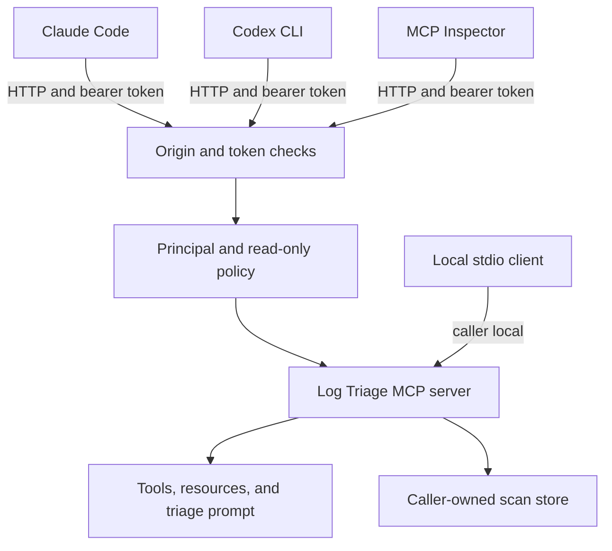

# Practice 4: Integrate with agents and clients (Python)
**Practice files**:

> [Contract](CONTRACT.md): Exact HTTP, caller, prompt, and error behavior
> [Host guide](hosts.md): Connect Claude Code and Codex CLI over HTTP
> [Investigation cases](cases.md): Questions to answer through an agent host
> [Example tokens](tokens.example.env): Local-only bearer-token configuration
> [Checklist](CHECKLIST.md): Manual completion checks and host observations
> [Coding-agent instructions](CLAUDE.md): Scope for AI-assisted work

Put the Log Triage server behind real agent hosts. You will add stateless Streamable HTTP, authenticate requests with local example bearer tokens, isolate scan state by caller, publish a guided `triage` prompt, and compare how two hosts present the same server.

This is the final stage of the project in `solution/`. Stdio remains the default, so all earlier practices must still pass.

## Links
- [FastMCP HTTP deployment](https://gofastmcp.com/deployment/http)
- [FastMCP token verification](https://gofastmcp.com/servers/auth/token-verification)
- [MCP prompts specification](https://modelcontextprotocol.io/specification/2026-07-28/server/prompts)
- [MCP Streamable HTTP specification](https://modelcontextprotocol.io/specification/2026-07-28/basic/transports/streamable-http)
- [MCP Inspector CLI](https://modelcontextprotocol.io/docs/2026-07-28/tools/inspector/cli)

**Project references**:

- [Earlier testing contract](../3-testing-and-debugging/CONTRACT.md)
- [Log format rules](../docs/log-formats.md)
- [Log bundle guide](../docs/s3-logs.md)

## What you will build
Your completed server will identify itself as `log-triage` version `0.4.0`, keep stdio as the default, and serve stateless Streamable HTTP at `/mcp` when started with `--http HOST:PORT`. It will map bearer tokens from `LOG_TRIAGE_TOKENS` to callers, keep each caller's scans private, hide `save_finding` from read-only callers, and publish the `triage` prompt.

The example token file is for local practice only. Do not use its values for a real service or commit personal tokens and host registration files.

## How hosts reach the server


*What to notice: HTTP requests carry a token, while stdio keeps the local caller. Both transports reach the same MCP surface and scan store.*

Stateless HTTP means one request does not depend on an HTTP session. A `scan_id` is application state that connects later requests to stored work. It does not authenticate the caller.

## MCP surface in this stage
The completed surface contains seven tools, two resources, two resource templates, and one prompt.

### Tools
| Tool | Main goal | Example input |
|------|-----------|---------------|
| `list_logs` | Discover files and formats | `{"path":"pods","limit":20}` |
| `summarize_logs` | Produce counts, groups, and a caller-owned scan | `{"path":"pods","since":"2026-09-09T09:00","until":"2026-09-09T13:00"}` |
| `search_logs` | Find raw evidence with a regular expression | `{"path":"pods","pattern":"(?i)invoice|timeout","limit":20}` |
| `group_lines` | Page one group from a scan | `{"scan_id":"<scan-id>","group_id":"<group-id>","limit":50}` |
| `read_lines` | Read context around one source line | `{"path":"path/from-a-result.log","line":123,"before":5,"after":10}` |
| `timeline` | Measure frequency and numeric movement across time buckets | `{"scan_id":"<scan-id>","pattern":"latency","bucket_minutes":60}` |
| `save_finding` | Save an evidence-backed report | `{"title":"Investigation title","severity":"high","summary":"...","evidence":[...]}` |

An analyst sees all seven tools. A read-only caller sees six because `save_finding` is absent. If that caller still sends a valid `save_finding` call, the server returns E13. The global `--read-only` flag removes the tool for everyone. `tools/list` has private cache scope because its result depends on the caller.

### Resources
| URI | Main goal | Example use |
|-----|-----------|-------------|
| `triage://formats` | Describe supported log formats | Read before comparing format-specific timestamps |
| `triage://reports` | List saved findings | Check which reports already exist |
| `triage://reports/{name}` | Read one finding | Read `triage://reports/example-finding` |
| `triage://scans/{scan_id}` | Read one caller-owned summary | Reopen a valid scan summary |

Another principal's scan is reported as not found. Resource lists and reads remain private.

### The `triage` prompt
The prompt frames an investigation for an agent with no prior knowledge of the log bundle.

| Argument | Required | Purpose |
|----------|----------|---------|
| `symptom` | yes | What the user observed |
| `path` | no | A file or folder to inspect |
| `since` | no | Start of the investigation window |
| `until` | no | End of the investigation window |

The rendered prompt repeats supplied arguments, names the tool order, asks for a quiet-window comparison, and requires source lines for claims. It describes a method without embedding case answers.

```bash
# Run from 4-agents-and-clients/ while the HTTP server is running.
npx @modelcontextprotocol/inspector --cli --config inspector.json --server log-triage-http --method prompts/get --prompt-name triage --prompt-args "symptom=pages time out" path=pods --format json
```

Agent hosts expose prompts through their own command syntax. Follow [hosts.md](hosts.md) for the Claude Code and Codex steps.

## Design reminders
| Component | Responsibility |
|-----------|----------------|
| Server | Publish operations, data, prompts, annotations, and errors |
| Transport | Carry MCP requests and responses |
| Authentication layer | Map a request token to a principal and policy |
| Host | Present the server, ask for tool permission, and run the model |
| Model | Choose tools and interpret their results |

A tool annotation helps a host choose an approval policy. The server still enforces write restrictions. Host permission is a user-interface decision; bearer-token policy and `--read-only` are server-side controls.

FastMCP's stateless HTTP transport does not erase application state. The server checks scan ownership against the token's principal on later requests.

## HTTP safety
For this local exercise, the request checks run in this order:

1. Refuse a non-local `Origin` with HTTP 403.
2. Refuse a missing or unknown bearer token with HTTP 401 and `WWW-Authenticate: Bearer`.
3. Attach the token's principal and read-only policy to the request.
4. Dispatch the MCP operation.

With `--http`, stdout stays empty. Startup and access diagnostics belong on stderr, or the access log may be disabled. Bind the example server to `127.0.0.1`, and do not treat these made-up tokens as production authentication.

The example file maps two analyst tokens to the same principal and one token to a read-only viewer. The analyst tokens may share a scan; a different principal may not.

## Repository map
Only the folders students need are shown. The completed implementation's internal file structure is omitted.

```text
build-your-own-mcp-fastmcp/
  1-surface-and-contract/     earlier regression checks
  2-state-safety-errors/      earlier regression checks
  3-testing-and-debugging/    earlier checks and test fixtures
  4-agents-and-clients/       current contract, host guide, cases, and checks
  docs/                       log formats and corpus notes
  reports/                    findings saved through an agent host
  s3_logs/                    read-only input corpus
  solution/                   your existing Python server, extended in place
```

`.mcp.json` and personal Codex configuration are machine-specific host registrations. Keep them out of the project commit.

## Set up the project
You need Python 3.13, uv 0.11 or newer, Node.js 22.19 or newer, Git, Claude Code, and Codex CLI or another second MCP host. The server pins FastMCP 4.0.3.

From the repository root:

```bash
# Run from the repository root.
uv run --project 1-surface-and-contract/checks pytest 1-surface-and-contract/checks
uv run --project 2-state-safety-errors/checks pytest 2-state-safety-errors/checks
uv run --project 3-testing-and-debugging/checks pytest 3-testing-and-debugging/checks
uv sync --project 4-agents-and-clients/checks
uv run --project 4-agents-and-clients/checks pytest 4-agents-and-clients/checks
```

The first three suites should pass. The fourth initially fails because the server does not yet provide HTTP, caller policy, or the `triage` prompt.

## Suggested build order
1. Add `--http` and stateless Streamable HTTP while preserving stdio.
2. Load token mappings and apply Origin and bearer checks.
3. Scope scan state and the visible tool list to the caller.
4. Add and test the `triage` prompt.
5. Run your own suite and all four practice suites.
6. Register the running HTTP server in two hosts using [hosts.md](hosts.md).
7. Solve the required cases from [cases.md](cases.md) and record what each host showed.

The practice lesson contains the coding-agent prompts. This README describes the completed behavior and how to exercise it.

## Start HTTP locally
Load the local example tokens, then start the server:

```bash
# Run from the repository root.
set -a
. 4-agents-and-clients/tokens.example.env
set +a
uv run --project solution log-triage --root s3_logs --reports reports --http 127.0.0.1:8765
```

The server waits at `http://127.0.0.1:8765/mcp`. Keep that terminal open while using the Inspector or a host. Stop it with Ctrl+C when finished.

## Verify each capability
```bash
# Run from the repository root.
uv run --project solution pytest solution/tests
uv run --project 4-agents-and-clients/checks pytest 4-agents-and-clients/checks
uv run --project 3-testing-and-debugging/checks pytest 3-testing-and-debugging/checks
uv run --project 2-state-safety-errors/checks pytest 2-state-safety-errors/checks
uv run --project 1-surface-and-contract/checks pytest 1-surface-and-contract/checks
```

| Check file | Capability |
|------------|------------|
| `test_t1_http.py` | HTTP startup, authentication, Origin checks, protocol compatibility, stdout, and logging |
| `test_t2_principals.py` | Caller-owned scans, read-only surfaces, private lists, per-caller caps, and findings |
| `test_t3_prompt.py` | Prompt arguments, descriptions, rendered guidance, ordering, and refusals |

## Inspect authentication and the prompt
With the HTTP server running, execute these commands from `4-agents-and-clients/`:

```bash
# Run from 4-agents-and-clients/.
npx @modelcontextprotocol/inspector --cli --config inspector.json --server log-triage-http --method tools/list --format json
npx @modelcontextprotocol/inspector --cli --config inspector.json --server log-triage-http-viewer --method tools/list --format json
npx @modelcontextprotocol/inspector --cli --config inspector.json --server log-triage-http-no-token --stored-auth-only --method tools/list --format json
```

The analyst entry lists seven tools. The viewer lists six without `save_finding`. The no-token entry reports an HTTP 401 authorization failure and exits with code 3. `--stored-auth-only` keeps the Inspector from starting OAuth.

Render the prompt:

```bash
# Run from 4-agents-and-clients/.
npx @modelcontextprotocol/inspector --cli --config inspector.json --server log-triage-http --method prompts/get --prompt-name triage --prompt-args "symptom=pages time out" path=pods --format json
```

The Inspector passes the multiword symptom as one argument. Host command parsers may behave differently, so [hosts.md](hosts.md) documents each one.

## Use real hosts
Follow [hosts.md](hosts.md) to register the HTTP endpoint in Claude Code and Codex CLI using environment-variable token names, compare analyst and viewer surfaces, verify write approval, and remove temporary registrations when the practice is complete.

Use the `triage` prompt and the questions in [cases.md](cases.md). Read each proposed write before allowing it, and check cited lines against the source files.

## Completion check
Run your own suite and all four practice suites, confirm the three Inspector token outcomes, render the prompt, connect both hosts, save findings for the two required cases, and record host behavior in [CHECKLIST.md](CHECKLIST.md). Confirm that no token or machine-specific registration enters the commit.
